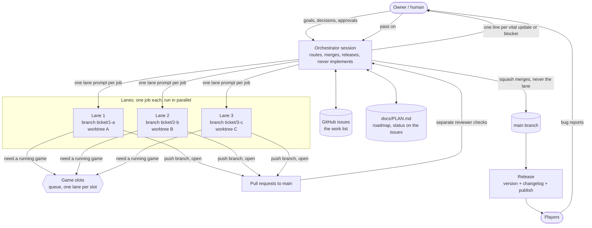

# Running a D2R mod project with AI agents

This guide explains a working method for building or porting a Diablo II: Resurrected mod with AI agents. It comes
from a large classic-to-D2R overhaul port that was run this way: one human owner, one orchestrator agent that
routes and never implements, and dozens of short-lived implementer and reviewer agents ("lanes").

You do not need all of it. A small mod can be one person and one agent. But once a project has more than a handful of
open problems, the pieces below keep it from falling apart.

Ready-made files for everything in this guide are in [`templates/`](../templates/). Three skills wrap the main
jobs: `d2r-orchestrator` (route lanes, review, merge, hand off), `d2r-project-conventions` (issues, PRs, branches, gate) and `d2r-release` (ship a version).

## Contents
1. [The big picture](#1-the-big-picture)
2. [The roles](#2-the-roles)
3. [Lanes: one job, one branch, one PR](#3-lanes-one-job-one-branch-one-pr)
4. [Choosing models and providers](#4-choosing-models-and-providers)
5. [Game slots and testing](#5-game-slots-and-testing)
6. [Releasing](#6-releasing)
7. [Safety: secrets, identity, public things](#7-safety-secrets-identity-public-things)
8. [Talking to the human owner](#8-talking-to-the-human-owner)
9. [Writing a good lane prompt](#9-writing-a-good-lane-prompt)
10. [Common failure modes and fixes](#10-common-failure-modes-and-their-fixes)
11. [Starter checklist](#11-starter-checklist)
12. [Using the skills from another project](#12-using-the-skills-from-another-project-local-plugin)
13. [Documentation audit](#13-documentation-audit)

---

## 1. The big picture



The loop in one sentence: **the owner decides, the orchestrator routes and merges, implementers do one job each and
open a pull request, a separate reviewer checks it, and every merged fix is released.**

### Decisions for a port

A port of a classic mod (see [porting-classic-mods.md](../knowledge/porting-classic-mods.md)) fixes these early, as
decisions the owner approves and the repo records (one short note each, for example an ADR). They shape every lane.

| Decision | Choice that worked | Why |
|---|---|---|
| Game and loader versions | Keep the game on one build (D2R 3.3, build 93847); the loader moves on its own schedule. Record the exact versions each test used. A loader update that breaks the port leaves it incompatible until fixed: do not change the game build to hide it | The game build is what engine addresses are tied to; the loader moves, and a silent pin hides breakage |
| Data or code | Data first; add a plugin only for a gap the data cannot close. Prefer a loader service over a native hook, and isolate each hook with a check of the bytes it patches. Adapt D2R's tables with reproducible transformations that carry the old rules in, instead of replacing D2R's tables with the old files | Data is cheap to review and survives game updates; hooks are build-specific |
| Saves | Decide the save format at the start. If the port needs the loader's extended saves, use them from the first build: a retail-format start with a later migration costs more. Extended saves do not load in retail D2R, so promise no compatibility outside the mod. Give the mod its own save folder, version the migrations and back up before each one; stop an incompatible setup before it touches a save | Changing the format later breaks every tester's characters |

None of these decisions shows that a particular rule works; each rule still needs its own check against the original.

## 2. The roles

| Role | Does | Never does |
|---|---|---|
| **Owner** (human) | Sets goals, answers questions, approves anything public, paid or destructive, plays the game, reports bugs. | Has to read code or run lane commands (the orchestrator gives copy-paste blocks). |
| **Orchestrator** (one long agent session) | Plans phases, keeps the work list on issues, splits work into lanes, writes lane prompts, starts implementers and reviewers (at most 5 implementer agents at once; reviewers do not count), squash-merges reviewed PRs, cleans up, releases, writes the handoff. | **Implements.** An orchestrator that codes gets slow and loses the overview; it routes. |
| **Implementer** (short agent session) | Does exactly one bug or feature on its own branch, runs the tests for what it touched, opens a PR, reports. | Merges, touches files outside its job, releases, waits on CI, or messages other agents. |
| **Reviewer** (short agent session, strongest model) | Reads one PR's diff against its issue and the rules, checks the tests are real, reports findings. | Is the agent that wrote the PR, or merges. |

Keep the orchestrator and every reviewer on your strongest model. They judge other agents' work, so they are the worst
place to save money.

## 3. Lanes: one job, one branch, one PR

**One bug or feature per lane.** Two bugs in one lane means one slow review, one big diff, and one fix you can't ship
without the other. If two reports look related, merge them into one issue first,
then give that one issue to one lane.

**Each lane works in its own checkout.** Use a git worktree (or a separate clone) so lanes never share a working
directory:

```bash
git fetch origin
git worktree add ../lanes/fix-crash-andariel -b ticket/123-fix-crash-andariel origin/main
```

To remove a finished lane worktree, use `tools/worktree_remove.ps1 -Path <worktree> [-DeleteBranch]`. A plain recursive
delete walks through a junction to a shared data cache and destroys it; the script unlinks every junction first, checks
the targets (and any `-Cache` folders; a relative symlink target counts from the link's folder) are unchanged, and refuses a locked, dirty or main-checkout target.

Rules that keep this safe:

- A lane branch is named `ticket/<n>-<slug>` (`research/<topic>`, `refactor/<topic>`; see the `d2r-project-conventions` skill) and starts from the current `origin/main`. The conventions skill and agent contract carry this rule. A lane
  that starts from some other branch drags that branch's changes into its PR.
- **Implementers open PRs and never merge.** A separate reviewer reads the diff and checks the tests; the
  orchestrator squash-merges once the reviewer reports no blocking findings and resolves conflicts. This is the main quality gate.
  Evidence: a project with a separate Opus-class reviewer and a fix-cycle cap caught what the writing agent missed
  without stalling.
- **At most 2 fix cycles per PR.** A cycle is: reviewer findings, implementer fix, re-review. After the second, merge
  what stands alone and file a follow-up issue for the rest. A third cycle rarely converges.
- **Workers never wait on CI and never touch runners.** Push, open the PR, report. The reviewer or orchestrator reads
  the checks later. A docs-only PR skips CI unless it touches the gate inputs (`d2r-project-conventions` skill).
- A lane only edits the files its job needs. If it finds a second problem, it writes it down in its report instead
  of fixing it. The orchestrator turns that into a new issue and a new lane.
- Merge in a separate worktree (`git worktree add --detach ../merge-wt origin/main`), not in the checkout a release
  job is using. Merges are **squash merges**; delete the branch afterwards (never `research/*`, `issue-assets`,
  `handoff/*`, `backup/*`).
- The lane's final report always has the same shape: PR link, head commit, what changed, what was tested and how,
  what is left. See [`templates/lane-prompt.md`](../templates/lane-prompt.md).
- **A lane that "finishes" while waiting on something has actually stopped.** Ending a turn ends the lane. Tell every
  lane: never end your turn while a build, install or game run you started is still going; wait for it in the same
  turn. If a lane reports "waiting for the run", check its branch and PR before you trust the report, then send it a
  follow-up telling it to continue.

### How the orchestrator runs a round

1. Read the open issues and the plan. Pick the next jobs. Close duplicates (`duplicate of #N`) before any work.
2. Write one prompt per job (from the template). Start the implementers, each on a fresh branch from `main`, never
   more than 5 implementer agents at once (reviewers do not count).
3. While they run, answer the owner (one line per vital update or blocker) and start a reviewer for each arriving PR using [`templates/reviewer-prompt.md`](../templates/reviewer-prompt.md).
4. Reviewer findings go back to the implementer (fix cycle 1, then 2 at most). When the reviewer reports no blocking findings,
   squash-merge in a separate worktree and run the targeted checks for the merged code.
5. Clean up: delete the branch, remove the worktree, clear stale slot locks.
6. When a batch of fixes is merged: release ([section 6](#6-releasing)).
7. When your context fills up: write the handoff ([below](#handoff)).

### Handoff

The orchestrator's context is finite. Before it fills, fill in [`templates/handoff.md`](../templates/handoff.md) (state,
running agents, waiting items, next jobs, decisions and traps not yet recorded elsewhere) and push it as the only file on
an **orphan branch** `handoff/orchestrator-<YYYY-MM-DD>`. Orphan, so it shares no history with `main` and never
shows in a diff; kept, never merged and never deleted. The next orchestrator starts by reading the newest one.

### Decision records

There is one baseline for what the mod is held to, and decisions about how it differs from it are **ADRs**, not
chat or a long-lived issue. One file per decision, `docs/adr/NNNN-<slug>.md`, from [`templates/ADR.md`](../templates/ADR.md):
Status, Context, Considered Options, Decision, Consequences, and dated Amendments at the end (later changes are added
there, not written over the original). A research document ([`templates/research.md`](../templates/research.md))
lists options and chooses nothing; the owner's choice becomes an ADR. A row of the deviations ledger
([`templates/deviations.md`](../templates/deviations.md)) cites its ADR, and the table-diff gate checks the ledger
against the tables. The roadmap ([`templates/PLAN.md`](../templates/PLAN.md)) links the ADRs that shape it and keeps
status on the issues, not in the file.

## 4. Choosing models and providers

Match the model to the risk of the job. Cheap models are fine for work where a mistake is obvious and easy to fix.
Expensive models pay for themselves on work where a mistake is subtle and costs a day.

| Job | Model tier | Why |
|---|---|---|
| Orchestrator session | Strongest | Routes everything, makes the calls. |
| Reviewer | Strongest (Opus class), always | Judges another agent's diff. |
| Reverse engineering the game binary, writing plugin/engine hooks, crash analysis, anything that touches code addresses, release-critical fixes, reconciling two lanes that fixed the same thing | **Strongest** (e.g. Claude Opus class) | Wrong guesses crash the game or corrupt saves, and the reasoning is long. |
| Data-table work, tools, scripts, tests, most bug lanes once you know roughly where the cause is, docs that need judgement, icon and image pipelines | **Mid** (e.g. Claude Sonnet class) | Good enough, much cheaper and faster. |
| Inventories, counting rows, grepping, renaming, converting a list, summarising logs, mechanical edits with a clear spec, test scaffolding, proofreading a diff for slips | **Small / cheap** (e.g. Claude Haiku class, or another provider's small model) | No design decisions are needed. |

### Multiple providers

Spread lanes over several accounts or providers when you can:

- It avoids rate limits and usage caps hitting all your lanes at once. Alternate heavy lanes between two accounts
  of the same provider.
- A different provider is a useful second pair of eyes. Use it for mechanical work and for a "does this diff have
  obvious slips" review. Treat its review as a hint, not a verdict.
- Look up the live provider and model names from your orchestration tool each session. They change often. Don't
  hard-code them in long-lived docs.

Give each lane a model on purpose: the table above is a default, and the orchestrator may promote a job to a stronger
model when a cheaper lane gets stuck twice.

## 5. Game slots and testing

Agents that run the real game need somewhere to run it. Sharing the player's own install is how saves get overwritten.

- Make a few **slots**: frozen copies of the game install in their own folders, each with its own save folder.
  Keep your own real game out of the pool and mark it "never touch".
- **Slots are queued, not added.** Do not make a new slot for every lane. A lane does all its offline work first,
  then makes one lock attempt on a slot that does not wait (`lock <N> <lane> --wait 0`, after status; never `lock any`), runs, restores the slot, and
  releases the lock. If no slot is free it stops, files (or asks the orchestrator to file) a `ready-for-agent` issue
  that holds the run's steps, and reports. It never polls or waits for a slot.
  Evidence: a long project settled on this because waits tie up an agent slot for nothing.
- **A lane only installs into or stops a game on a slot it holds the lock for, checked at that moment.** Never kill
  processes by a broad filter; kill only the process ids the lane started.
- Put the slot number on *every* command that touches saves or a game folder (an environment variable or a flag).
  A shell does not keep `export`s between tool calls, and a tool that defaults to slot 1 will overwrite whoever
  holds slot 1.
- Tests run in the background. Nothing may send synthetic keyboard or mouse input or steal focus, because the human
  may be using the machine.
- Lanes use their own throwaway characters. They never move, rename or delete saves they did not create.

### Targeted tests, full suite at milestones

After a change, run only the checks for the code that changed: map each source file to the checks that exercise it,
and run those, plus the cheap always-on checks (the build validator, unit tests, a boot smoke test). The full suite is
slow and game-bound. Run it at milestones: end of a phase, before a big release, before the owner plays after many
changes. And then one game at a time.

### Test what players get

A developer install is not what players have. Developer installs often use debug switches, loose text tables and a
test harness that is compiled out of release builds. Bugs hide there and appear for players. So:

- For anything player-facing, install the **release package** onto a slot exactly as your installer would (a
  `release_install` style script), run the check, then restore the slot.
- Verify the game, loader and plugin versions in the player's report against yours before chasing a ghost. Many
  "bugs" are a stale plugin copy or the loader pointing at another mod.
- Crash reports from players need the loader log and the crash report file. A plugin's own log stops silently when
  the game dies.

## 6. Releasing

**Release after every batch of fixes**, not once a quarter. Small releases make it obvious which change broke what, and
players see their report get answered.

The steps (the `d2r-release` skill walks through them):

1. All fixes for the version are merged and the targeted checks pass.
2. Bump the version (once, in one place).
3. Fold the changelog fragments. Nobody writes a version section by hand: every PR that players will notice adds a
   small file to `changelog.d/` in the player's words ([`templates/changelog.d/README.md`](../templates/changelog.d/README.md)),
   and the release stager folds them into the `### <version> (<date>)` section of
   `CHANGELOG.md`. Evidence: two PRs editing the same changelog lines conflict; fragments
   never do.
4. Run the **whole release as one script** with `set -euo pipefail`, which stops at the first failed step and refuses
   to run if the version, the changelog and the build disagree.
5. Create the public release pages only after the version is confirmed live.
6. Close the fixed issues with the version in the closing comment.

Hard-won rules:

- **Don't switch branches, rebase, or edit in the checkout a release is running from.** Tags and package contents
  are read from the working tree while the job runs. One release got its tag on the wrong commit this way. Capture
  the commit hash first and do other work in a separate worktree.
- **Never pipe publish output through `tail`, `head` or `grep`** in the release script. A pipe hides the exit code of
  the failing command, and a failed upload was reported as a success. If you want a shorter log, write it to a
  file and read the file.
- Generated files can change line endings after a build. A real content change in a generated file must be committed
  before the release; a pure line-ending change should not block it.
- Compare any server-side script that ingests uploads with the repo's copy before you publish.
- Publishing is outward-facing: the first time, and any time the target or channel changes, ask the owner.

## 7. Safety: secrets, identity, public things

- **Secrets stay out of chat and out of the repo.** Tokens, passwords and private keys live in files in the user's
  home folder (for example `~/.my-mod/api_token`) that the owner creates themselves. Scripts read them. Agents
  never print them, echo them, commit them or put them in a prompt, a PR body or a log. If an agent genuinely needs a
  new secret, the owner enters it through a private input channel, never in the conversation.
- **Commit identity is a noreply address.** Set `user.name` and `user.email` to the owner's public handle and the
  host's `...@users.noreply...` address, for every lane. Never use a real e-mail in a commit, a doc or a prompt. Give
  the exact `git -c user.name=... -c user.email=... commit` form in the lane rules, so a lane that forgot to configure
  git still commits correctly.
- Commit messages end with a `Co-Authored-By:` line naming the model, and PR bodies end with the tool's
  attribution line, if the owner wants them. Say which in the lane rules.
- **Private words list.** Keep a text file *outside* the repo with names that must never be published (other
  projects, real names, hosts, addresses). Run a scan against it before every commit and before every push to
  a public place. See `tools/check_public.py`. The list itself never goes in the repo.
- **Never commit game files.** Blizzard's files are read from the user's own install. Not dumps, not extracted
  tables, not saves, not screenshots of the game.
- **Ask before anything public, paid or destructive**: making a repo public, publishing a release, a force-push,
  deleting branches or saves, spending money, touching the owner's real game install.
- Downloaded archives and installers are untrusted. Unpack them into a new empty folder, don't run their executables,
  and run any Python that reads them with `-I`.

## 8. Talking to the human owner

The owner is busy and isn't reading code. The orchestrator sends **one line per vital update or blocker**, and nothing
else (no running commentary, no status when nothing changed):

- `DONE:` something that matters was merged or released, with the issue numbers.
- `BLOCKED:` work stops, and what unblocks it.
- `NEED:` a decision or action from the owner, as one clear question with a recommendation, or a **copy-paste block**
  with the expected output.

Don't ask a question the code, the docs or a sensible default can answer; pick the default, say you did, and move on.

[`templates/owner-update.md`](../templates/owner-update.md) has a ready-made shape.

## 9. Writing a good lane prompt

A lane starts with no memory, but the issue, agent contract and pinned skills are its context. Use [lane-prompt.md](../templates/lane-prompt.md) for one scoped outcome, exact references, verified facts versus hypotheses, ruled-out approaches, task-only constraints and concrete acceptance checks. If the issue already specifies these, reference it instead of copying it.

State whether a game check is needed and name it; the testing skill owns slot policy. For RE name the target image and address references; the engine skill owns byte re-verification, unique signatures and compatibility. The agent contract and project conventions own Git, safety, required tests and reporting. Never repeat them in every brief.

Keep new standing rules at their canonical owner, not in each prompt. See the maintainer-only [migration ledger](context-rule-ledger.md). A reviewer uses [reviewer-prompt.md](../templates/reviewer-prompt.md).

## 10. Common failure modes and their fixes

| What goes wrong | Why | Fix |
|---|---|---|
| A lane "completes" but nothing was pushed. | It ended its turn while a build or run was still going, or it ran out of steam. | Check the branch and worktree. Send a follow-up that says to continue. Put "never end a turn while something you started is running" in the rules. |
| A lane's PR contains unrelated changes. | The lane started from a branch other than `main`, or the orchestrator had another branch checked out. | Always branch from `origin/main`. Start lanes from `main`. Cherry-pick the real commits into a clean branch. |
| Two lanes fix the same root cause two ways. | The duplicate issues were never closed. | Keep one approach. Turn the other into a self-check so nothing is corrected twice. Close duplicates before assigning. |
| One lane overwrote another's installed build or save. | No lock, or the lane unlocked between install and test. | Lock a slot for the whole session, check the lock right before installing, put the slot on every command. |
| A lane killed someone else's game. | Broad process kill. | Kill only process ids the lane started. |
| Tests pass on your install, players still crash. | Developer install is not the release package. | Test with the release installer on a slot. Compare file hashes with the player's. |
| The release says "success" but the version is not online. | Output piped through `tail`, or no `set -e`. | Use a single script with `set -euo pipefail`, no pipes on the publish steps, and create public pages only after a live-version check. |
| Release tag points at the wrong commit. | The checkout was switched or rebased mid-release. | Capture the commit hash first, never touch the release checkout, merge elsewhere. |
| The same lane keeps failing the same way. | Wrong model or missing context. | Re-brief with what it tried, or promote the job to a stronger model. Two failures is the limit for the same prompt. |
| Agents invent column values or addresses. | Nothing to check against. | Make them clone the nearest vanilla row, and require byte checks for addresses. |
| A token or e-mail showed up in a PR. | Secrets in prompts or logs. | Rotate the token. Scan before every commit. Keep secrets in files outside the repo. |
| The orchestrator is buried in detail. | It is doing lane work. | Delegate, keep only the plan, the issues and the merges. |
| A PR keeps bouncing between reviewer and implementer. | Findings are vague, or the job is two jobs. | At most 2 fix cycles: merge what stands alone, file a follow-up issue for the rest. |
| The new orchestrator session starts blind. | No handoff. | Write the handoff on an orphan `handoff/orchestrator-<date>` branch before the context fills. |
| Players report a crash you can't reproduce. | Setup problem: wrong loader mod folder, stale plugin copy, different build. | Have the plugin log its own path, version and the other loaded plugins at startup. Ask for the loader log and the crash report. |
| A lane stalls waiting for a game slot forever. | All slots locked by lanes that ended without unlocking. | Check slot status. Stale locks from finished lanes are cleared by the orchestrator. |
| Docs drift from reality. | Nobody owns them. | Docs updates are part of the lane's "done". The reviewer checks them at merge. |

## 11. Starter checklist

For a new project follow [orchestrator setup](orchestrator-setup.md); do not reload it for every lane.

Setting up a project:

- [ ] Repo created, `main` protected in practice (only the orchestrator merges).
- [ ] `docs/PLAN.md`, `docs/deviations.md`, `changelog.d/` (and `CHANGELOG.md` from its README) created from the templates.
- [ ] `AGENTS.md` and `docs/agents/` written; private-words list created outside the repo; `tools/check_public.py` wired in (`tools/install_hooks.py --root <mod repo>`).
- [ ] Commit identity decided (noreply address) and written into the rules.
- [ ] Game slots set up and locked-down; the owner's real install marked untouchable.
- [ ] Tokens and keys placed by the owner in files in their home folder.
- [ ] Orchestrator prompt filled in from [`templates/orchestrator-prompt.md`](../templates/orchestrator-prompt.md).
- [ ] First lanes chosen: setup and inventory first, then tools, then data.

Per bug:

- [ ] One issue, duplicates closed.
- [ ] One lane, one branch, one PR, one reviewer.
- [ ] Targeted checks run; release-package test for player-facing fixes.
- [ ] At most 2 fix cycles, then squash-merged by the orchestrator. Branch deleted, worktree removed.
- [ ] Released with a changelog fragment. Issue closed with the version.

## 12. Using the skills from another project (local plugin)

The `d2r-*` skills live in `.claude/skills/`, so they only load in sessions started inside this repository. To use
them from a mod project's own repository, register this checkout as a local plugin marketplace once. The checkout is
both the marketplace (`.claude-plugin/marketplace.json`) and the plugin (`.claude-plugin/plugin.json`, plugin
`d2r-toolkit`). The plugin manifest points at `.claude/skills/`, so every skill folder in it is exposed, including
ones added later; there is no list to maintain.

One-time setup, in your user settings (`~/.claude/settings.json`; merge these keys into the file, keep your other
settings). Replace `<path-to-toolkit>` with the absolute path of your toolkit checkout (use forward slashes on
Windows):

```json
{
  "extraKnownMarketplaces": {
    "d2r-local": {
      "source": { "source": "directory", "path": "<path-to-toolkit>" }
    }
  },
  "enabledPlugins": {
    "d2r-toolkit@d2r-local": true
  }
}
```

The same can be done from a shell: `claude plugin marketplace add <path-to-toolkit>` then
`claude plugin install d2r-toolkit@d2r-local`. Check the result with `claude plugin list`, and validate the manifests
after editing them with `claude plugin validate <path-to-toolkit>`.

Notes:

- A marketplace added from a local path is read in place, not copied: pulling the toolkit changes the skills at the
  next session start or after `/reload-plugins`.
- Plugin skills are namespaced: `/d2r-toolkit:d2r-skill`. Inside this repository the same skills also load without the
  prefix, so each skill loads twice there (about 1.2k always-on tokens per copy). To turn the plugin off in the
  toolkit repo only, put `{ "enabledPlugins": { "d2r-toolkit@d2r-local": false } }` in the toolkit's
  `.claude/settings.local.json`.
- In a skill's text, `${CLAUDE_PLUGIN_ROOT}` is replaced by the absolute path of the toolkit checkout when the skill
  loads from the plugin. Every toolkit file a skill names (`knowledge/`, `docs/`, `templates/`, `tools/`, `testing/`)
  is written as `${CLAUDE_PLUGIN_ROOT}/...`, so it resolves from any project. Inside this repository nothing
  substitutes it, and the placeholder means the repository root. Write new skills the same way.
- The plugin also registers a `SessionStart` hook (`hooks/hooks.json`, script `hooks/stale_branch.sh`) that runs in
  every session which loads the plugin. It fetches `origin/main` (capped at 5 seconds, never prompts) and prints a
  one-line warning when the checkout's HEAD does not contain it, so a lane does not build or open a PR on a stale
  base. It only warns, always exits 0, and prints nothing outside a git repo, without `origin/main`, or when HEAD is current. Set
  `D2R_STALE_NO_FETCH=1` to skip the fetch (offline work).
- `python -m modkit build <project>` still runs with the toolkit checkout as the working directory and the mod
  project as the argument. `tools/check_public.py` scans its `--root` (default: the current directory), so run it
  as `py -3 <path-to-toolkit>/tools/check_public.py --root <mod repo>` or from inside the mod repo.

## 13. Documentation audit

Docs drift while code changes. Periodically (at each milestone, and before a release) the orchestrator starts one
implementer for a **documentation audit**: it checks every claim and link in the docs against `main`.

- Every file path, command, flag, skill name and issue or ADR number a doc names still exists and still does what the
  doc says. Run the commands that are cheap to run.
- Every relative link and anchor resolves; every skill link uses `${CLAUDE_PLUGIN_ROOT}/...`.
- Numbers (counts, limits, versions, build numbers) match their source. Two docs that state the same fact agree.
- The audit writes down findings with file and line, fixes the small ones in its own PR (one topic per PR), and files
  an issue for each larger one. It changes no behaviour. Findings that need a decision keep the question and the
  evidence in the issue instead of a guess.
- A reviewer checks the audit PR like any other.
